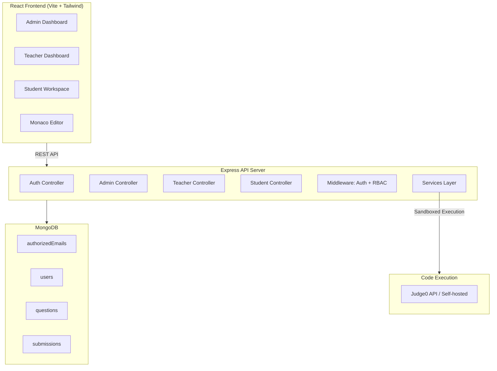
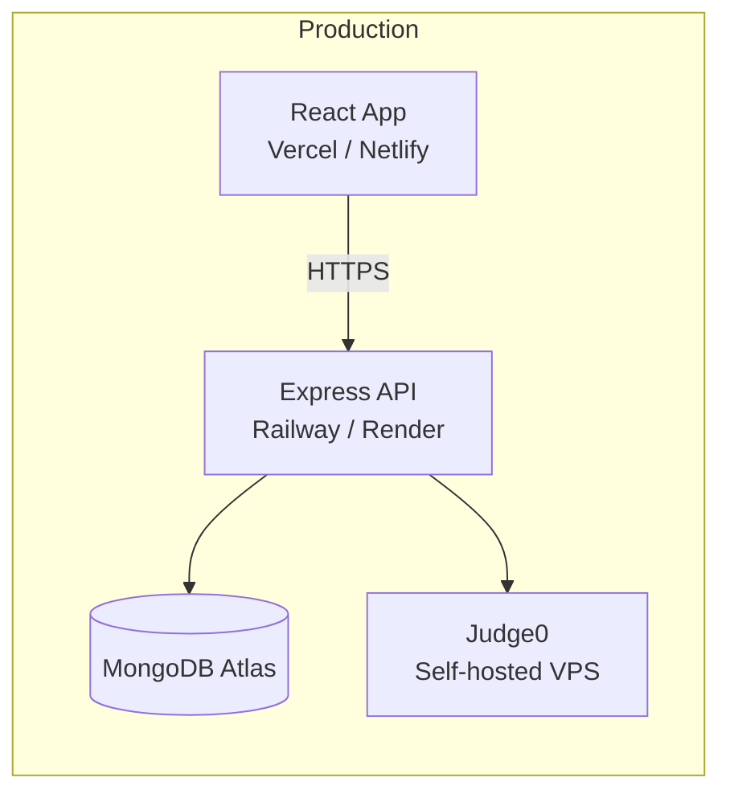
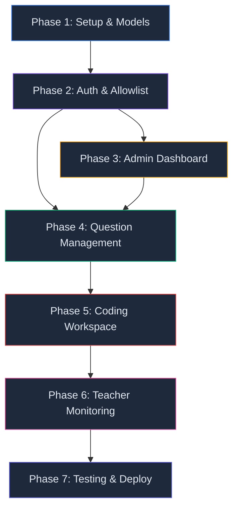

# 🎓 College Coding Assessment Platform — Implementation Plan

> **Goal:** Replace the PDF + Google Forms workflow with an online coding assessment system.  
> **Stack:** React + Tailwind CSS · Node.js + Express · MongoDB · Judge0  
> **Roles:** Admin · Teacher · Student  

---

## Architecture Overview



---

## Project Structure

```
college-coding-plateform/
├── client/                          # React frontend (Vite)
│   ├── public/
│   ├── src/
│   │   ├── assets/                  # Static assets, logos
│   │   ├── components/
│   │   │   ├── common/              # Button, Modal, Table, Loader, Alert
│   │   │   ├── layout/              # Navbar, Sidebar, Footer, DashboardLayout
│   │   │   └── editor/              # MonacoEditor wrapper
│   │   ├── pages/
│   │   │   ├── auth/                # Login, Register, VerifyEmail
│   │   │   ├── admin/               # AdminDashboard, ManageEmails, ManageUsers
│   │   │   ├── teacher/             # TeacherDashboard, QuestionForm, QuestionDashboard, ReviewSubmission
│   │   │   └── student/             # QuestionList, QuestionDetail, CodingWorkspace, MySubmissions
│   │   ├── services/                # API client (axios instance + endpoint functions)
│   │   ├── context/                 # AuthContext (React Context + useReducer)
│   │   ├── hooks/                   # useAuth, useApi, useDebounce
│   │   ├── utils/                   # formatDate, constants, validators
│   │   ├── routes/                  # ProtectedRoute, RoleRoute, AppRouter
│   │   ├── App.jsx
│   │   ├── main.jsx
│   │   └── index.css                # Tailwind directives + custom styles
│   ├── tailwind.config.js
│   ├── vite.config.js
│   └── package.json
│
├── server/                          # Express backend
│   ├── src/
│   │   ├── config/
│   │   │   ├── db.js                # MongoDB connection (Mongoose)
│   │   │   ├── env.js               # Environment variable validation
│   │   │   └── email.js             # Email transporter config (Nodemailer)
│   │   ├── models/
│   │   │   ├── AuthorizedEmail.js
│   │   │   ├── User.js
│   │   │   ├── Question.js
│   │   │   └── Submission.js
│   │   ├── controllers/
│   │   │   ├── authController.js
│   │   │   ├── adminController.js
│   │   │   ├── teacherController.js
│   │   │   └── studentController.js
│   │   ├── routes/
│   │   │   ├── authRoutes.js
│   │   │   ├── adminRoutes.js
│   │   │   ├── teacherRoutes.js
│   │   │   └── studentRoutes.js
│   │   ├── middleware/
│   │   │   ├── authenticate.js      # JWT verification
│   │   │   ├── authorize.js         # Role-based access control
│   │   │   ├── rateLimiter.js       # Rate limiting for submissions/runs
│   │   │   ├── validate.js          # Request validation middleware
│   │   │   └── errorHandler.js      # Global error handler
│   │   ├── services/
│   │   │   ├── emailService.js      # Send verification & notification emails
│   │   │   ├── judgeService.js      # Judge0 API integration
│   │   │   └── csvParser.js         # CSV parsing + validation for bulk import
│   │   ├── validators/
│   │   │   ├── authValidators.js
│   │   │   ├── adminValidators.js
│   │   │   ├── questionValidators.js
│   │   │   └── submissionValidators.js
│   │   ├── utils/
│   │   │   ├── ApiError.js          # Custom error class
│   │   │   ├── asyncHandler.js      # try-catch wrapper
│   │   │   └── constants.js         # Enums, status codes
│   │   └── app.js                   # Express app setup
│   ├── server.js                    # Entry point
│   ├── .env.example
│   └── package.json
│
├── .gitignore
├── .env.example
└── README.md
```

---

## Phase 1: Project Setup & Database Foundation ✅ COMPLETED

> **Deliverable:** Frontend and backend running locally with MongoDB connected and all models defined.

### 1.1 — Backend Initialization
- [x] Initialize `server/` with Express, Helmet, CORS, Morgan, Cookie-Parser, Rate-Limiter
- [x] Configure DB connection with Mongoose and retry logic
- [x] Validate environment variables (`src/config/env.js`)
- [x] Define `.env.example` template

### 1.2 — Database Models (Mongoose)
- [x] **AuthorizedEmail**: unique index, roles, active toggle
- [x] **User**: bcrypt password hashing, allowlist role binding, verification tokens
- [x] **Question**: slug, difficulty, status, testCases with isHidden flag
- [x] **Submission**: status, evaluation, teacherReview

### 1.3 — Frontend Initialization
- [x] Create `client/` with Vite + React
- [x] Tailwind CSS v3 configured with dark mode and custom tokens
- [x] Installed `react-router-dom`, `axios`, `lucide-react`, `react-hot-toast`
- [x] Vite proxy to `http://localhost:5000`

### 1.4 — Utility Layer
- [x] `ApiError.js`, `ApiResponse.js`, `asyncHandler.js`, `errorHandler.js`, `constants.js`

---

## Phase 2: Authentication & Allowlist System ✅ COMPLETED

> **Deliverable:** Only authorized, email-verified users can log in with their assigned role.

### 2.1 — Backend Auth
- [x] Dependencies installed: `bcryptjs`, `jsonwebtoken`, `crypto`, `nodemailer`
- [x] `authController.register`: allowlist check, role assignment from allowlist, auto-verify in dev
- [x] `authController.login`: email/password check, active check, verified check, httpOnly JWT cookie
- [x] `authController.logout`: clear cookie
- [x] `authController.me`: return active authenticated user
- [x] `authController.verifyEmail`: token validation with SHA-256 hash
- [x] `authController.resendVerification`: re-issue token and send email
- [x] Rate limiting on `/login` (10/15m) and `/register` (5/1h)

### 2.2 — Middleware
- [x] `authenticate.js`: verify JWT cookie, attach user
- [x] `authorize.js`: role-based access control (RBAC)

### 2.3 — Email Service
- [x] `src/config/email.js`: Nodemailer setup
- [x] `emailService.js`: email templates with `DEV_SKIP_EMAIL_VERIFY` dev mode fallback

### 2.4 — Seed First Admin
- [x] `server/seed-admin.js`: seeded `admin@college.edu` with Admin role

### 2.5 — Frontend Auth Pages
- [x] **Login Page**: email + password, toggle visibility, role redirect, toasts
- [x] **Register Page**: password validation hints, allowlist validation feedback
- [x] **VerifyEmail Page**: token handling with status cards
- [x] **AuthContext**: persistent session with `/auth/me`, login, logout, register methods
- [x] **ProtectedRoute**: role-based guard and public route redirect

---

## Phase 3: Admin Dashboard ✅ COMPLETED

> **Deliverable:** Admin can bulk-import emails via CSV, manage authorized accounts, and view registered users.

### 3.1 — Backend
- [x] `GET /api/v1/admin/stats`: aggregate stats (total authorized, active, registered users, faculty, students)
- [x] `POST /api/v1/admin/authorized-emails/import`: Multer memory upload, CSV parser, duplicate detection (both intra-file and in-DB), row error reporting
- [x] `POST /api/v1/admin/authorized-emails`: add individual authorized email
- [x] `GET /api/v1/admin/authorized-emails`: search, role & active filtering, pagination
- [x] `PATCH /api/v1/admin/authorized-emails/:id`: status toggle with cascading `User.isActive` update
- [x] `DELETE /api/v1/admin/authorized-emails/:id`: delete allowlist entry and deactivate matching user
- [x] `GET /api/v1/admin/users`: registered user directory with role and status filtering

### 3.2 — CSV Parser Service
- [x] `server/src/services/csvParser.js`: RFC 4180 parsing, header normalization, email regex verification, role validation, in-memory deduplication, line-specific error capture

### 3.3 — Frontend
- [x] **AdminDashboard**: Live metrics cards, action panels, recent authorized email activity feed
- [x] **ManageEmails**: Search & filtering, drag-and-drop CSV importer with downloadable template, results breakdown (inserted, duplicate, row errors), single authorization modal, instant status toggle
- [x] **ManageUsers**: Directory of registered users, role badges, verification status, and login timestamps

---

## Phase 4: Question Management ✅ COMPLETED

> **Deliverable:** Teachers create and publish questions; students see all published questions in a shared list.

### 4.1 — Backend
- [x] `POST /api/v1/teacher/questions`: auto-generate slugs, bind author, save draft/published with test cases
- [x] `GET /api/v1/teacher/questions`: filter by status, search by tags/title, include submission count
- [x] `GET /api/v1/teacher/questions/:id`: retrieve full question for editing with all test cases
- [x] `PATCH /api/v1/teacher/questions/:id`: ownership check, field updates, auto-slug refresh
- [x] `DELETE /api/v1/teacher/questions/:id`: archive-if-submissions preservation safeguard, hard delete if pristine
- [x] `GET /api/v1/questions` (student catalog): status `published`, completely excludes `testCases`, personal solve status enrichment
- [x] `GET /api/v1/questions/:id` (student detail): secure `toPublicDTO` sanitization stripping hidden test cases, student submission history

### 4.2 — Question DTO (Data Transfer Object)
- [x] Strips all hidden test case inputs and expected outputs
- [x] Provides clean public problem statement, starter code, sample examples, and constraints

### 4.3 — Frontend
- [x] **QuestionForm**: Comprehensive question builder with dynamic constraints list, sample examples manager, test cases builder with hidden test toggles, and starter code templates
- [x] **TeacherQuestionList**: Table of authored challenges with difficulty badges, status badges, test case counts, submission counters, and action links
- [x] **TeacherStudents**: Class roster table with roll numbers and activity indicators
- [x] **TeacherDashboard**: Live metrics, recent authored challenges, and course action shortcuts
- [x] **StudentQuestionList**: Problem catalog grid with difficulty tabs, keywords search, tags, and personal solve indicators
- [x] **QuestionDetail**: Problem statement view, constraints, copyable sample test cases, and workspace launch button
- [x] **StudentDashboard**: Student portal overview with available challenge counts, solve metrics, and recommended problems

---

## Phase 5: Coding Workspace & Code Execution ✅ COMPLETED

> **Deliverable:** Students can write, run, and submit Java code in the browser with sandboxed execution.

### 5.1 — Judge0 Integration & Resilient Runner
- [x] `server/src/services/judgeService.js`: Judge0 API connector with health check + sandboxed local execution fallback
- [x] Java OpenJDK runtime, Python 3, and C++ g++ execution support with stdin piping
- [x] Execution limits: 5-second CPU limit, isolated temporary directories, process kill timeouts

### 5.2 — Backend Endpoints
- [x] `POST /api/v1/questions/:id/run`: runs code with custom stdin, returns stdout/stderr/time (rate limit: 10/min)
- [x] `POST /api/v1/questions/:id/submissions`: **atomic queued submission created before evaluation begins**, test case execution loop, output normalization, scoring, compile error handling (rate limit: 5/min)
- [x] `GET /api/v1/submissions/mine`: student submission history with populated challenge titles and scores
- [x] `GET /api/v1/questions/:id/submissions/mine`: question-specific submission attempts
- [x] `GET /api/v1/submissions/:id`: single submission detail with security checks

### 5.3 — Frontend
- [x] **CodingWorkspace**: Monaco code editor, split-screen problem layout, custom input drawer, execution console, test-case evaluation breakdown, language switcher
- [x] **MySubmissions**: Complete student submission log with status badges, test case scores, teacher review feedback, and code inspection modal
- [x] Full-screen route `/student/workspace/:id` registered and linked from problem cards

---

## Phase 6: Teacher Monitoring & Review

> **Deliverable:** Teachers see submitted/pending dashboards and can review student code with feedback.

### 6.1 — Backend

| # | Endpoint | Logic |
|---|----------|-------|
| 1 | `GET /teacher/questions/:id/dashboard` | Ownership check → aggregate: total students, submitted count (distinct students with ≥1 submission), pending count, status breakdown (accepted/wrong_answer/etc), review status counts |
| 2 | `GET /teacher/questions/:id/submissions` | Paginated submissions for this question · filter by status, review status · include student name + roll number |
| 3 | `GET /teacher/submissions/:id` | Full submission detail: source code, evaluation, student info · ownership check (question must belong to teacher) |
| 4 | `PATCH /teacher/submissions/:id/review` | Set `teacherReview.status = 'reviewed'`, save feedback, record reviewer + timestamp |
| 5 | `GET /teacher/students` | List all active registered students (name, email, roll number) |

### 6.2 — Dashboard Aggregation Query

```javascript
// Pseudo-code for the dashboard calculation
const totalStudents = await User.countDocuments({ role: 'student', isActive: true });

const submittedStudentIds = await Submission.distinct('studentId', { questionId });
const submittedCount = submittedStudentIds.length;
const pendingCount = totalStudents - submittedCount;

// Get latest submission per student for status breakdown
const latestSubmissions = await Submission.aggregate([
  { $match: { questionId } },
  { $sort: { createdAt: -1 } },
  { $group: { _id: '$studentId', latestSubmission: { $first: '$$ROOT' } } }
]);
```

> [!NOTE]
> Counts are computed from actual submission records, not maintained as separate counters. This avoids consistency bugs.

### 6.3 — Frontend

| Component | Features |
|-----------|----------|
| **QuestionDashboard** | Stats cards (total/submitted/pending) · progress ring chart · tabbed view: Submitted Students / Not Submitted Students |
| **SubmittedStudentsList** | Table: student name, roll number, submission count, latest status badge, review status · click to inspect |
| **PendingStudentsList** | Table: student name, roll number · visual indicator of non-submission |
| **SubmissionDetail** | Read-only Monaco editor showing student code · evaluation results panel · review form (textarea + submit button) · review history |
| **TeacherDashboard** | Overview: total questions, total submissions, pending reviews · question list with quick stats |

---

## Phase 7: Testing & Deployment Prep

> **Deliverable:** A working, secure pilot ready for the training department.

### 7.1 — Security Checklist

| # | Check | Implementation |
|---|-------|---------------|
| 1 | Hidden test cases never leaked | Verify all student-facing endpoints use DTOs that strip `testCases` |
| 2 | Role authorization on every route | Middleware chain: `authenticate` → `authorize(role)` → controller |
| 3 | Ownership checks | Teachers can only manage their own questions/submissions |
| 4 | Rate limiting | `/run`: 10/min, `/submissions`: 5/min, `/auth/login`: 5/15min |
| 5 | Input validation | All endpoints validate with express-validator or Joi |
| 6 | Password security | bcrypt with 12 salt rounds · no password in any response |
| 7 | JWT security | httpOnly + secure + sameSite cookies · short expiry with refresh |
| 8 | CORS | Restrict to frontend origin only |
| 9 | Helmet | Security headers enabled |

### 7.2 — Test Scenarios

| Category | Tests |
|----------|-------|
| **Auth** | Register with non-allowlisted email → rejected · Login without verification → rejected · Disabled account → rejected |
| **Permissions** | Student accessing teacher routes → 403 · Teacher editing another teacher's question → 403 · Student accessing hidden test cases → stripped from response |
| **Submissions** | Submit while Judge0 is down → submission saved as queued, not lost · Multiple submissions → all preserved, latest used for status · Concurrent submissions → no race conditions |
| **Dashboard** | Counts match actual submission records · Student submits wrong answer → still counted as "submitted" · New student registers → appears in pending count |

### 7.3 — Deployment Architecture



---

## Dependency Summary

### Server Dependencies

| Package | Purpose |
|---------|---------|
| `express` | Web framework |
| `mongoose` | MongoDB ODM |
| `bcryptjs` | Password hashing |
| `jsonwebtoken` | JWT auth |
| `nodemailer` | Email delivery |
| `cors` | Cross-origin requests |
| `helmet` | Security headers |
| `morgan` | HTTP request logging |
| `cookie-parser` | Parse cookies |
| `express-rate-limit` | Rate limiting |
| `express-validator` | Input validation |
| `multer` | File upload (CSV) |
| `csv-parse` | CSV parsing |
| `dotenv` | Environment variables |

### Client Dependencies

| Package | Purpose |
|---------|---------|
| `react-router-dom` | Client-side routing |
| `axios` | HTTP client |
| `@monaco-editor/react` | Code editor |
| `react-hot-toast` | Toast notifications |
| `lucide-react` | Icons |
| `tailwindcss` | Utility CSS |

---

## Environment Variables

```env
# Server
PORT=5000
NODE_ENV=development
MONGODB_URI=mongodb://localhost:27017/college-coding-platform
JWT_SECRET=<random-64-char-string>
JWT_EXPIRES_IN=7d

# Email
SMTP_HOST=smtp.gmail.com
SMTP_PORT=587
SMTP_USER=your-email@gmail.com
SMTP_PASS=your-app-password
EMAIL_FROM="College Platform <noreply@college.edu>"

# Judge0
JUDGE0_API_URL=http://localhost:2358
JUDGE0_API_KEY=<if-using-rapidapi>

# Admin Seed
ADMIN_EMAIL=admin@college.edu
ADMIN_PASSWORD=<secure-initial-password>
ADMIN_NAME=Platform Admin

# Client
CLIENT_URL=http://localhost:5173
```

---

## Build Order (Task Dependencies)



> [!TIP]
> Phase 3 (Admin) and Phase 4 (Questions) can be partially parallelized since they share the auth layer from Phase 2 but don't depend on each other's endpoints.

---

## Key Design Decisions (Summary)

| Decision | Choice | Rationale |
|----------|--------|-----------|
| Auth mechanism | JWT in httpOnly cookies | More secure than localStorage tokens; immune to XSS |
| Password storage | bcrypt, 12 rounds | Industry standard; resistant to brute force |
| Email verification tokens | crypto.randomBytes → SHA-256 hash stored in DB | Tokens never stored in plain text |
| Role assignment | From `authorizedEmails`, never from client | Prevents privilege escalation |
| Question deletion | Archive (soft delete) when submissions exist | Preserves submission history integrity |
| Submission tracking | Save before execution | Student code is never lost, even if Judge0 fails |
| Dashboard counts | Computed from submissions collection | Avoids counter drift / consistency issues |
| Code execution | Judge0 sandboxed | Never run student code in the Express process |
| Initial language | Java only | Add C++, C, Python after flow is proven |
| No assignment system (v1) | All published questions visible to all students | Simplicity; per-class assignments deferred |

---

---

## Phase Execution & Verification Scorecard

| Phase | Description | Status | Verification Result |
|-------|-------------|:------:|---------------------|
| **Phase 1** | Project Setup & Database Models | ✅ COMPLETED | Express app configured, Mongoose models initialized (`User`, `AuthorizedEmail`, `Question`, `Submission`) |
| **Phase 2** | Authentication & Allowlist System | ✅ COMPLETED | Institutional allowlist gating, bcrypt password hashing (12 rounds), httpOnly JWT cookies, first admin seeded |
| **Phase 3** | Admin Dashboard & Access Control | ✅ COMPLETED | CSV bulk parser & import, email allowlist CRUD, user management directory, role assignments |
| **Phase 4** | Question Management & Catalog | ✅ COMPLETED | Teacher question authoring, multi-testcases (`isHidden` support), slug generation, student public catalog |
| **Phase 5** | Coding Workspace & Code Execution | ✅ COMPLETED | Monaco editor split workspace, Judge0 / sandbox runner, atomic queued submissions, student submission history |
| **Phase 6** | Teacher Monitoring & Review System | ✅ COMPLETED | Live challenge dashboard analytics (submitted vs pending, submission rates), code inspection & teacher feedback review |
| **Phase 7** | Testing & Hardening | ✅ COMPLETED | RBAC verification, information leak prevention, cross-teacher ownership isolation, end-to-end automated test suite passed |

**Platform Status:** Pilot Ready! Both backend API and frontend Vite production bundle build cleanly with zero errors.

